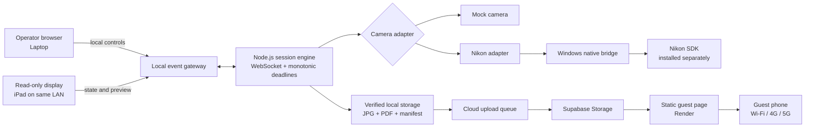

# CAP Photobooth

**An operator-led, multi-device photobooth built around a real Nikon Z30.** CAP coordinates camera capture on a Windows laptop, mirrors the live session to a read-only tablet display, composes a custom sticker frame, and gives each finished session its own QR download link.

> The camera and session controller run locally beside the USB-connected camera. Cloud services are used only to deliver a verified finished JPG to guests over the internet; they do not control the camera.

## Why this project is interesting

A photobooth looks simple until several parts must agree at once: a camera can take a photo before a transfer finishes, a countdown can drift between screens, a USB SDK can become busy, and a guest may be on a completely different network. CAP treats those as one coordinated workflow rather than a collection of independent timers and buttons.

- **One source of truth:** a backend state machine owns the session, countdown deadlines, camera operations, and save verification. Operator and display clients receive the same authoritative WebSocket state.
- **Failure-aware capture:** exactly four photos per session; each shutter follows a server-side 10-second countdown. Captures never overlap, the next countdown waits for a verified save and camera readiness, and uncertain shutter operations are never retried automatically.
- **Two-device experience:** the laptop is the operator console; the iPad is a display-only screen with live preview, countdown, capture feedback, the finished frame, and a session-specific QR.
- **Real hardware, behind an adapter:** a Nikon camera interface separates the state machine from both a deterministic mock camera and a Windows native bridge for Nikon's separately installed SDK.
- **Print-ready composition:** eight photos are placed into the supplied transparent two-strip artwork. Photos are rendered first and the original sticker frame is layered on top. The system exports a final JPG and PDF.
- **Internet-friendly delivery:** only the verified final JPG is queued for cloud upload. A per-session, unguessable QR link becomes available only after read-back verification. Guests can download over Wi-Fi or cellular data.
- **Portable event launch:** Windows scripts package and start the local app on the event laptop. No public camera-control server or developer laptop is required at the venue.

## System overview



The event laptop must stay on and connected to the Nikon during a session. The iPad must be able to reach the laptop over the local network. Guests can use any internet connection to retrieve a QR-linked image after it has uploaded. The app does not depend on the developer's laptop.

## Architecture

| Workspace | Responsibility |
| --- | --- |
| `frontend/` | React 19 + TypeScript operator console, display-only experience, live preview, QR and browser tests |
| `backend/` | Node.js + TypeScript state machine, WebSocket events, camera adapters, file verification, composition and cloud queue |
| `shared/` | Shared session models and event contracts used across the frontend and backend |
| `native/` | C++ Windows bridge for the Nikon SDK boundary; vendor SDK files are intentionally not included |
| `cloud/guest/` | Static, mobile-friendly guest page that resolves a QR link and downloads the finished JPG |
| `tools/` | Windows event launcher, safe shutdown, camera setup, packaging, cloud configuration and deployment checks |
| `assets/templates/` | Supplied transparent frame artwork and measured photo-opening geometry |

## Session lifecycle

```text
IDLE
  → COUNTDOWN (10 seconds)
  → CAPTURING
  → SAVING and verification
  → next COUNTDOWN …
  → COMPOSING and final-file verification
  → COMPLETE
```

The same server-issued deadline is broadcast to every connected screen; clients do not run independent session timers. A capture or save failure moves the session to `ERROR` and requires operator attention. Cancellation prevents future captures and lets already-started work settle safely. A session reaches `COMPLETE` only after all four records and final outputs are verified.

## Technology

- React 19, TypeScript, Vite
- Node.js, TypeScript, Express, WebSocket
- C++ native bridge and Nikon SDK integration boundary
- Sharp for image processing; PDF-Lib for print output
- Supabase Storage for guest photo delivery; Render Static Site for the guest page
- Vitest, Playwright (Chromium and WebKit), native C++ regression tests

## Run locally in mock mode

### Requirements

- Node.js 22.12 or later (Node 24 recommended)
- npm
- Windows 11 for the event launcher and native Nikon integration; the mock web app can be developed on other Node-supported platforms

```powershell
npm ci
npm run build
$env:CAMERA_MODE = 'MOCK'
npm run dev
```

Open the operator page on the laptop at [http://localhost:5173/operator](http://localhost:5173/operator). Open `/display` on a tablet on the same Wi-Fi using the laptop's current LAN IP, for example `http://<laptop-ip>:5173/display`.

The mock camera creates clearly identified test images and never sends a shutter command. For the packaged Windows launcher, build the frontend first; `npm run event:mock` runs the isolated mock event. `Test Mock.cmd` is the event-folder shortcut.

## Real Nikon Z30 setup

The Nikon SDK is **not included** in this repository or the event ZIP. Obtain it from Nikon under its applicable license. Install the Windows x64 prerequisites, connect and power the Z30 over USB, and close NX Tether and other camera-control applications before setup.

For source development, build the bridge and use the interactive camera tools:

```powershell
$env:NIKON_SDK_ROOT = 'C:\path\to\separately-installed\Nikon-SDK'
npm run camera:build
npm run camera:setup
npm run camera:probe
npm run camera:test
```

The one-photo hardware validation tool requires an explicit confirmation in the interactive terminal. A successful validation report is required before real four-photo sessions unlock. Never use a mock result as real-camera validation. See [CAMERA_FEASIBILITY.md](CAMERA_FEASIBILITY.md) and [HANDOFF_VI.md](HANDOFF_VI.md) for hardware, event-laptop, Wi-Fi and Windows Firewall details.

For an event, `npm run event:package` creates a Windows x64 ZIP under the ignored `.local/releases/` directory. The organizer installs the Nikon SDK separately on the event laptop, validates its connected camera, configures that machine's cloud uploader, and runs `Start Photobooth.cmd`. The SDK, credentials, captured photos and validation report are excluded from the ZIP and Git.

## Guest downloads and deployment boundary

The `cloud/guest/` directory is the public static photo-download experience; it is not the camera application. The Windows laptop still runs the camera, countdown, state machine and local operator UI. Supabase stores only a completed, framed JPG after upload and SHA-256 read-back verification. A random link is created per four-photo session; it does not expose the operator interface, originals, PDF, manifest, live view or camera controls.

Set up a Supabase Storage bucket and its access policies using [`cloud/storage.sql`](cloud/storage.sql), deploy **only** `cloud/guest/` as a static site, then run `Configure Cloud.cmd` on the event laptop. It asks for the project URL, publishable/anon key, and a dedicated uploader account; the password is entered securely and stored in the machine-local ignored `.local/` directory. **Never use a Supabase service-role/secret key in the client or organizer laptop.**

The guest site can be hosted independently (the project includes a Render static-site blueprint in `render.yaml`). Only the guest page and its public image-download route belong on public hosting. Do not deploy the Nikon backend, operator routes or camera bridge as a public service.

## Verification

Automated checks included in the repository:

```powershell
npm test
npm run build
npm run test:e2e
npm run test:deployment
npm run camera:test:native   # requires the separately installed SDK/toolchain
```

At the latest recorded verification, the project passed 83 backend tests, 8 browser tests across Chromium/WebKit, a production-gateway security integration test, native bridge regression checks, and the TypeScript/Vite production build. A physical Nikon Z30 was used for real capture and Live View validation. Hardware tests require a camera and Nikon SDK; the repository's ordinary test suite uses mocks and does not trigger a shutter.

## Safety and privacy notes

- Operator controls are local to the camera laptop; the iPad display has no capture controls.
- Backend and Nikon SDK services bind to loopback. The event gateway exposes only the display, approved media and operator surface needed on the LAN.
- The public guest service handles a narrowly scoped, random-link download. It cannot start sessions or access camera operations.
- Credentials, generated images, local cloud configuration, SDK binaries and hardware-validation artifacts are ignored and must remain out of Git.
- Guest QR links are bearer links: anyone who receives a link can view that session's shared JPG. Provide the event's privacy notice and retention policy separately; this version does not automatically expire uploaded photos.
- A network interruption may delay a guest QR becoming ready. The local capture and verified output remain on the event laptop; upload retries do not repeat camera captures.

## Project notes

- [Task decomposition](TASK_DECOMPOSITION.md)
- [Project rules](project_rules.md)
- [Camera feasibility and SDK boundary](CAMERA_FEASIBILITY.md)
- [Windows event-laptop handoff (Vietnamese)](HANDOFF_VI.md)
- [Implementation and verification report](IMPLEMENTATION_REPORT.md)

---

Built as a practical systems project: camera hardware, responsive interfaces, distributed state, safe file handling and guest delivery brought together in one operator-led experience.
